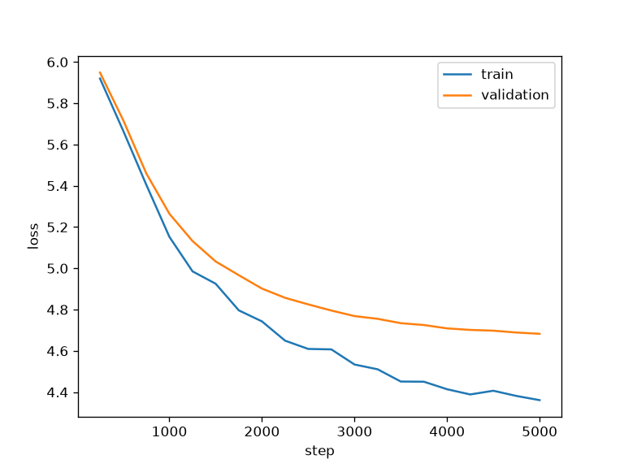
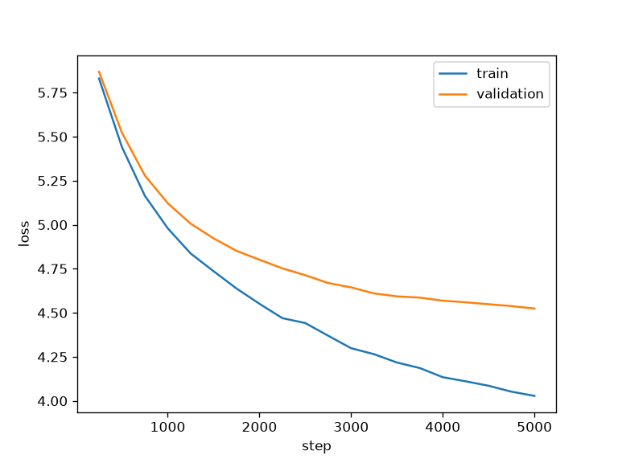

# 唐诗生成模型实验记录

## 实验结果对比

每次实验结束后在下表追加一行，统一记录最后一次评估的 Train 和 Validation loss（越低越好）。

| Step（实验名称） | Train | Validation |
| --- | ---: | ---: |
| baseline | 4.361 | 4.683 |
| test1 | 4.028 | 4.524 |


## Baseline（基线实验）

### Config（实验配置）

```json
{
  "student_id": "26051852g",
  "n_layer": 2,
  "n_head": 4,
  "n_embd": 128,
  "block_size": 64,
  "max_steps": 5000,
  "batch_size": 64,
  "learning_rate": 0.001,
  "weight_decay": 0.1,
  "dropout": 0.2,
  "eval_interval": 250,
  "temperature": 0.8,
  "top_p": 1.0
}
```

### Output（实验输出）

#### 损失曲线



#### 验证结果与生成参数

| 指标 / 参数 | 数值 |
| --- | --- |
| Validation loss（验证损失） | 4.683 |
| Temperature（采样温度） | 0.8 |
| Top-p（核采样阈值） | 1.0 |

#### 生成诗歌示例

```text
極，採桃多，蒼。桃李非芳光，相搖驚素草。車馬赴洛口，瀘水饒秦水。酒家雖不折，沈坐言不弭。
```

## Test1（实验一）

本次将 `n_embd` 从基线的 128 增加到 256，其余记录中的配置保持一致。

### Config（实验配置）

```json
{
  "student_id": "26051852g",
  "n_layer": 2,
  "n_head": 4,
  "n_embd": 256,
  "block_size": 64,
  "max_steps": 5000,
  "batch_size": 64,
  "learning_rate": 0.001,
  "weight_decay": 0.1,
  "dropout": 0.2,
  "eval_interval": 250,
  "temperature": 0.8,
  "top_p": 1.0
}
```

### Output（实验输出）

#### 损失曲线



#### 验证结果与生成参数

| 指标 / 参数 | 数值 |
| --- | --- |
| Validation loss（验证损失） | 4.524 |
| Temperature（采样温度） | 0.8 |
| Top-p（核采样阈值） | 1.0 |

验证损失取自当前 `project1/output/26051852g.json` 中的 `val_loss`（4.524216246992142），低于基线记录的 4.683。

#### 生成诗歌示例

```text
四面偏相遇，長才猶未成。山苗偏絕節，江樹不生生。草色添春意，山城有夜烹。何時之子徒，可以戒吾生。
```

